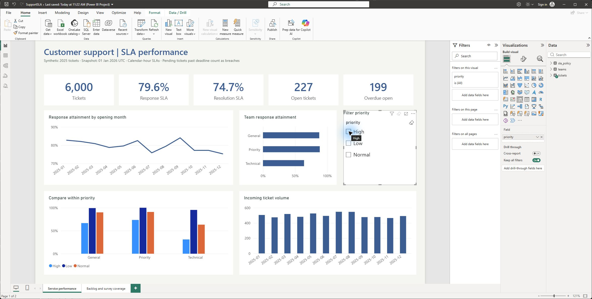
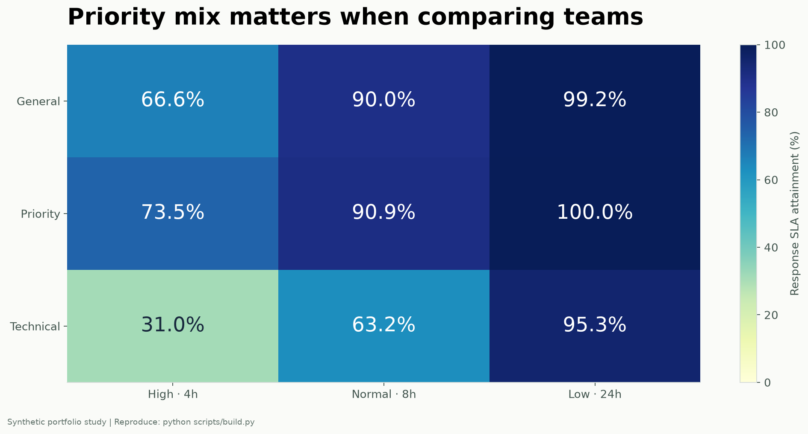

# Customer support SLA review

Where are response deadlines being missed, and which unresolved tickets already need escalation?

Among 6,000 synthetic tickets, response attainment is **79.6% over 5,995 eligible tickets**. There are **199 overdue open tickets**. Technical / High has **31.0% response attainment**; compare within priority before ranking teams.

**Tools and methods:** SQL aggregation · snapshot deduplication · timestamp validation · censored denominators · survey bias · Power Query and DAX.



## Review the work

| Artifact | What to inspect |
|---|---|
| [Decision memo](analysis/findings.md) | Findings, recommended action, assumptions and limits |
| [Power BI project](powerbi/SupportSLA.pbip) | Two editable report pages and a portable semantic model |
| [Walkthrough video](docs/recordings/walkthrough.mp4) | Actual Power BI captures, assembled into a narrated-by-caption step walkthrough |
| [Screenshot gallery](docs/screenshots/README.md) | Dashboard, filter, relationships and loaded data |
| [Executed notebook](analysis/analysis.ipynb) | SQL outputs rendered for browser review |
| [SQL](sql) / [result tables](analysis) | Runnable queries and committed CSV results |
| [Data dictionary](docs/data-dictionary.md) | Grain, keys, units, metric definitions and null handling |
| [Quality report](analysis/quality_report.json) / [quarantine](analysis/quarantine.csv) | Cleaning counts and rejected records |
| [DAX measures](powerbi/measures.dax) | Readable measures used by the report |



## Data preparation

6,100 raw snapshot rows → 90 superseded snapshots removed → 10 invalid timestamp rows quarantined → 6,000 clean tickets. Independent timestamp-based tests verify eligibility and breach flags for every ticket.

The repository includes raw and cleaned CSVs, a SQLite warehouse, an executed notebook, four PNG/SVG charts, and the Power Query source for each imported table. [Review guide](docs/review-guide.md) explains how to trace a dashboard number back to SQL and source data.

## Open in Power BI Desktop

1. Clone or download **the entire repository**. Keep the report and semantic-model folders together.
2. Open `powerbi/SupportSLA.pbip` in a current Power BI Desktop with PBIP/PBIR support.
3. Select **Home → Refresh**. Local caches are excluded, so an initial empty report is expected until refresh completes.
4. Use the page tabs and slicer to inspect segments. Relationships are visible in Model view.

The Power Query model embeds the cleaned synthetic CSV snapshot as Base64. It needs no credentials, absolute paths, gateway or external service. Refresh reloads that embedded snapshot; after changing data, run `scripts/build_powerbi.py` and reopen the project or apply external changes. This is editable PBIP source, not a pre-cached PBIX download. Native loading, refresh and filtering were checked in Power BI Desktop on Windows on 2026-11-19.

## Reproduce the analysis

Python 3.13 was used for the checked-in build. Run from the repository root in a virtual environment:

```sh
python -m venv .venv
# Windows PowerShell: .venv\Scripts\Activate.ps1
# macOS/Linux: source .venv/bin/activate
python -m pip install -r requirements.txt
python scripts/build.py
python scripts/build_powerbi.py
python -m unittest discover -s tests -v
```

The build regenerates the seeded synthetic data, cleans it, runs the SQL, exports the figures and executes the notebook. It **overwrites generated datasets and analysis outputs**; do not use it to import your own files. Data hashes are recorded in `analysis/data_sha256.json`. Notebook execution metadata and figure metadata need not be byte-identical across runs.

Optional report-schema validation (Node.js/npm):

```sh
npx --yes @microsoft/powerbi-report-authoring-cli@0.5.0 validate powerbi/SupportSLA.pbip
```

CI rebuilds the analysis and model, checks data integrity and reconciliations, and validates report schemas. It does not run the Windows Power BI UI. The native screenshots complement these automated checks.

## Provenance

This is an **AI-assisted portfolio case study using explicitly synthetic data**. The generator intentionally encodes analytical patterns and data-quality defects. Findings are simulated, not employer outcomes or evidence of achieved business impact. Code and report definitions were generated programmatically; the screenshots show the resulting project opened and exercised in native Power BI Desktop. Walkthrough videos are edited sequences of those captures, not continuous recordings of manual authoring. See [media provenance](docs/recordings/README.md).

Power BI project format: [Microsoft documentation](https://learn.microsoft.com/en-us/power-bi/developer/projects/projects-overview). No Microsoft endorsement is implied.
