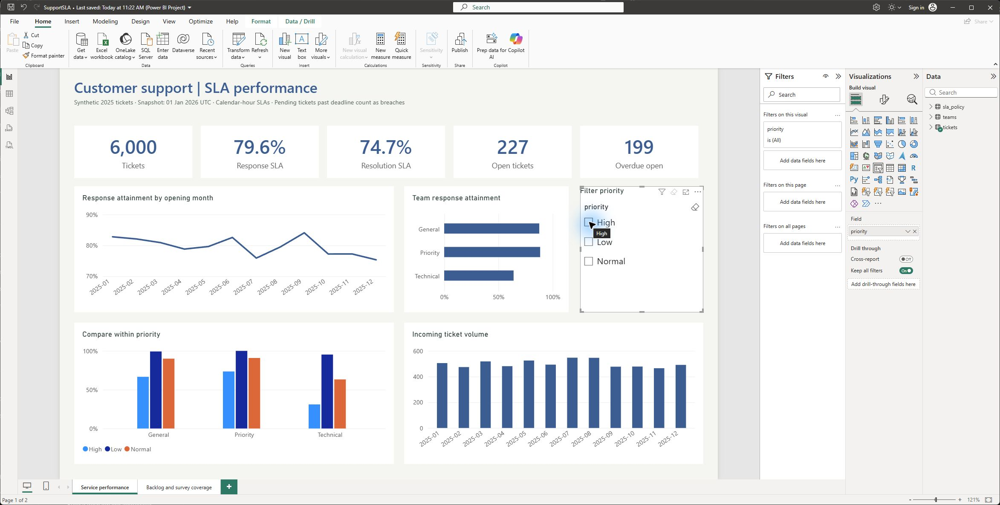
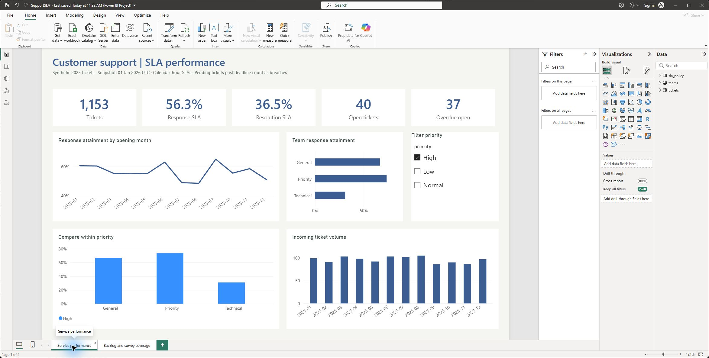
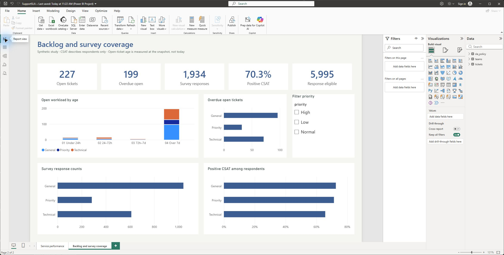
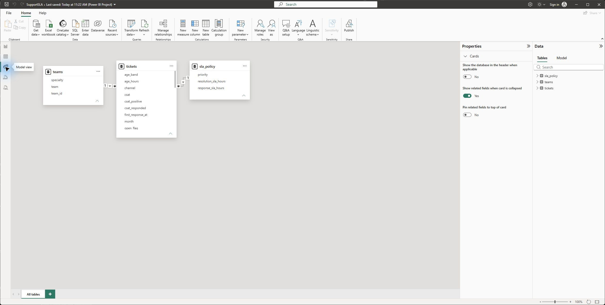
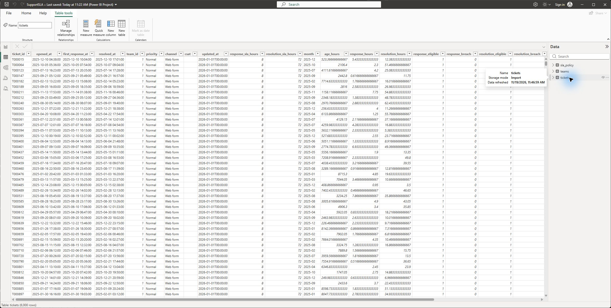
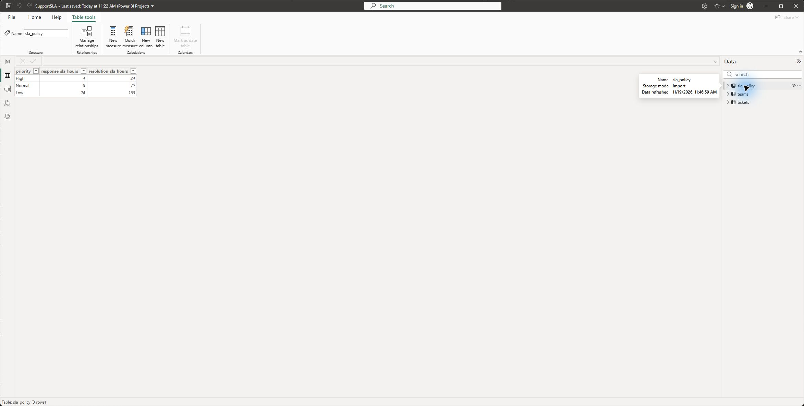

# Native Power BI captures

Captured on 2026-11-19 from the actual editable project in Power BI Desktop. All displayed records are synthetic.

## SLA overview

6,000 tickets; 79.6% response attainment; 199 overdue open tickets.

## High-priority filter

1,153 tickets; 56.3% response attainment; 37 overdue open.

## Backlog and survey coverage

227 unresolved tickets and 1,934 survey respondents; CSAT describes respondents only.

## Relationships

Team and priority-policy dimensions filter the ticket fact.

## Loaded tickets

6,000 unique clean tickets loaded, with timestamps and eligibility flags.

## Deadline policy

High: 4/24 hours; Normal: 8/72; Low: 24/168. All use calendar hours.

